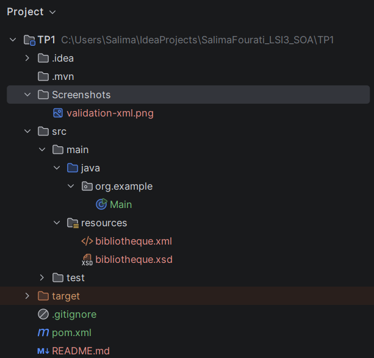
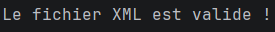
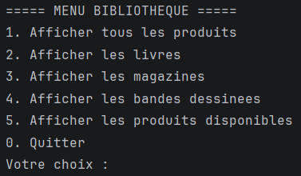
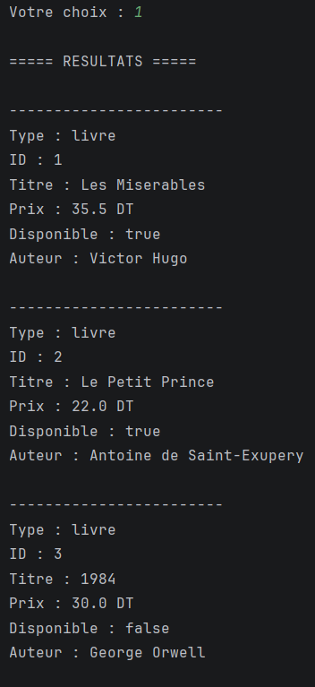
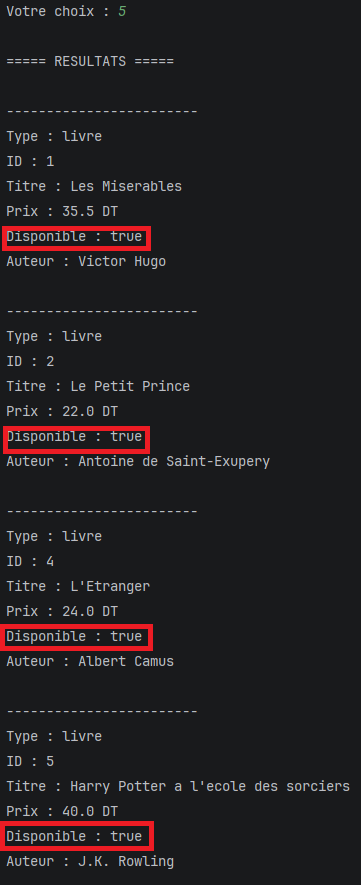

# BookSphere — Système de Gestion d’un Catalogue de Produits Culturels avec XML, XSD et XPath

## Informations générales

| Élément | Description |
| :--- | :--- |
| **Projet** | BookSphere — Gestion d’un Catalogue de Produits Culturels |
| **Matière** | Architecture SOA et Web service |
| **Étudiante** | Salima Fourati |
| **Groupe** | LSI 3 2TP2 |
| **Année universitaire** | 2026–2027 |
| **Technologies** | Java, XML, XSD, XPath et Maven |
| **Environnement de développement** | IntelliJ IDEA |

## 1. Présentation du projet

**BookSphere** est une application Java développée dans le cadre d’un TP consacré aux technologies XML
Ce projet Java permet de gérer et de consulter les produits d'une bibliothèque à partir d'un fichier XML.
Il utilise un fichier XSD pour vérifier la validité du document XML et XPath pour rechercher les produits selon différents critères.
Le programme propose un menu interactif qui permet à l'utilisateur de choisir les informations à afficher.

## 2. Objectifs

Les objectifs principaux de ce projet sont :

- Modéliser un catalogue de livres, de magazines et de bandes dessinées à l’aide de XML.
- Organiser les informations dans une structure hiérarchique claire.
- Définir les règles et les contraintes des données avec un schéma XSD.
- Contrôler la conformité du document XML par une validation automatique.
- Exploiter XPath pour rechercher et filtrer les produits selon différents critères.
- Développer une application Java permettant de consulter les données du catalogue.
- Découvrir l’utilisation de XML dans les architectures orientées services (SOA).
- Organiser et configurer le projet à l’aide de Maven.

## 3. Technologies utilisées

| Technologie | Description / Rôle |
| :--- | :--- |
| **Java** | Langage de programmation |
| **Maven** | Gestion et organisation du projet |
| **XML** | Stockage des données de la bibliothèque |
| **XSD** | Définition et validation de la structure XML |
| **XPath** | Recherche et sélection des éléments XML |
| **IntelliJ IDEA** | Environnement de développement |

## 4. Structure du projet

```text
TP1/
├── src/
│   ├── main/
│   │   ├── java/
│   │   │   └── org.example/
│   │   │       └── Main.java
│   │   └── resources/
│   │       ├── bibliotheque.xml
│   │       └── bibliotheque.xsd
│   └── test/
├── pom.xml
└── README.md
```
## 5. Description des fichiers

| Fichier | Description |
| :--- | :--- |
| **Main.java** | Valide le XML, lit les données et affiche le menu interactif. |
| **bibliotheque.xml** | Contient les informations des produits de la bibliothèque. |
| **bibliotheque.xsd** | Définit la structure et les règles de validation du XML. |
| **pom.xml** | Contient la configuration du projet Maven. |

## 6. Architecture SOA (Service-Oriented Architecture)

L'architecture SOA repose sur des services indépendants qui communiquent entre eux à travers des API.

## Principaux composants

| Composant | Description |
| :--- | :--- |
| **Fournisseur de services** | Propose des fonctionnalités aux autres applications. |
| **Consommateur (client)** | Envoie des requêtes pour utiliser ces fonctionnalités. |
| **Annuaire de services** | Référence les services disponibles pour faciliter leur découverte. |
| **Contrat de service** | Définit les opérations proposées et les règles de communication. |

**Lien avec BookSphere :**

Dans le projet, `Main.java` joue le rôle de client en lisant le catalogue stocké dans `bibliotheque.xml`. Actuellement, le programme utilise directement les fichiers XML et XSD, sans communication entre services via une API. Une évolution possible serait de créer un service web exposant le catalogue et de permettre à l'application Java de l'interroger à travers une API.

## 7. Présentation de XML

**XML (*eXtensible Markup Language*)** est un langage de balisage permettant de structurer, stocker et échanger des données dans un format hiérarchique et lisible.

### Objectifs et avantages

- Organiser les données de manière structurée.
- Faciliter l'échange de données entre différentes applications.
- Séparer les données de leur traitement.
- Permettre la validation des données grâce à XSD.
- Faciliter la recherche d'informations avec XPath.

### Utilisation dans le projet

Dans **BookSphere**, le fichier `bibliotheque.xml` stocke les informations des livres, magazines et bandes dessinées.

Exemple :

```xml
<livre id="1">
    <titre>Les Miserables</titre>
    <auteur>Victor Hugo</auteur>
    <prix>35.5</prix>
    <disponible>true</disponible>
</livre>
```

**Lien avec Java :** la classe `Main.java` utilise `DocumentBuilder` pour lire le fichier XML et `getElementsByTagName()` et `getTextContent()` pour récupérer les informations des produits et les afficher.

## 8. XML et structuration des métadonnées

**Les métadonnées** sont des informations qui décrivent les données et permettent de mieux les identifier et les comprendre.

Dans le projet **BookSphere**, les balises XML jouent un rôle descriptif en précisant la nature de chaque information : <titre> indique le titre du produit, <prix> représente son prix et <disponible> précise sa disponibilité. L'attribut id permet également d'identifier chaque produit.

Exemple :

```xml
<livre id="1">
    <titre>Les Miserables</titre>
    <auteur>Victor Hugo</auteur>
    <prix>35.5</prix>
    <disponible>true</disponible>
</livre>
```
Dans cet exemple, les balises et l'attribut fournissent un contexte qui facilite l'interprétation des données par l'application Java.

## 9. Présentation de XSD

XSD (*XML Schema Definition*) est un langage qui permet de définir la structure et les contraintes d'un document XML, notamment les éléments, les attributs et les types de données autorisés.

### Exemple de code XSD

Dans le projet **BookSphere**, le fichier `bibliotheque.xsd` définit la structure d'un livre :

```xml
<xs:element name="livre">
    <xs:complexType>
        <xs:sequence>
            <xs:element name="titre" type="xs:string"/>
            <xs:element name="auteur" type="xs:string"/>
            <xs:element name="prix" type="xs:decimal"/>
            <xs:element name="disponible" type="xs:boolean"/>
        </xs:sequence>
        <xs:attribute name="id"
                      type="xs:positiveInteger"
                      use="required"/>
    </xs:complexType>
</xs:element>
```

### Rôle dans le projet

Le schéma XSD garantit que les livres, magazines et bandes dessinées respectent la structure attendue. Il permet notamment de vérifier la présence des éléments obligatoires, leur ordre, leurs types de données et les attributs requis.

## 10. Validation XML avec Java

Le programme valide le fichier `bibliotheque.xml` par rapport au schéma `bibliotheque.xsd`.

Le processus de validation comprend les étapes suivantes :

1. Charger le schéma XSD.
2. Créer un validateur à partir du schéma.
3. Vérifier la conformité du document XML.
4. Afficher un message de réussite ou une erreur selon le résultat.

La validation utilise les classes Java `SchemaFactory`, `Schema` et `Validator`.

### Validation réussie

Si le document XML respecte les règles définies dans le schéma XSD, le programme affiche :

```text
Le fichier XML est valide !
```

### Test avec un XML invalide

Pour tester la validation :

1. Ouvrir `bibliotheque.xml`.
2. Remplacer le prix d'un produit par le texte `trente`.
3. Relancer le programme.
4. Vérifier que la validation échoue, car le prix doit être un nombre décimal (`xs:decimal`).
5. Restaurer la valeur initiale.

Ce test montre que XSD permet de détecter les données non conformes et de garantir la structure attendue du catalogue.

## 11. Utilisation de XPath

XPath (*XML Path Language*) permet de rechercher et de sélectionner des éléments dans un document XML à l'aide de requêtes.

Dans **BookSphere**, XPath est utilisé pour afficher les produits selon leur catégorie ou leur disponibilité.

### Exemples de requêtes XPath

| Requête | Résultat |
|---|---|
| `/bibliotheque/*` | Tous les produits |
| `/bibliotheque/livre` | Tous les livres |
| `/bibliotheque/magazine` | Tous les magazines |
| `/bibliotheque/bandeDessinee` | Toutes les bandes dessinées |
| `/bibliotheque/*[disponible='true']` | Les produits disponibles |

### Utilisation en Java

```java
XPath xpath = XPathFactory.newInstance().newXPath();

NodeList produits = (NodeList) xpath.evaluate(
        "/bibliotheque/livre",
        document,
        XPathConstants.NODESET);
```

Cette requête sélectionne tous les livres du catalogue. Les résultats sont récupérés dans un `NodeList`, puis parcourus pour afficher les informations correspondantes.

Ces requêtes sont utilisées par le menu interactif pour filtrer et consulter les produits du catalogue.

## 12. Screenshots

Cette section présente les principales fonctionnalités de l’application **BookSphere** à travers des captures d’écran.

### 12.1. Structure du projet

Cette capture montre l’organisation du projet Maven dans IntelliJ IDEA, avec les fichiers Java, XML et XSD.



### 12.2. Validation du document XML

Cette capture montre le message de confirmation affiché lorsque le fichier `bibliotheque.xml` respecte les règles définies dans `bibliotheque.xsd`.



### 12.3. Menu principal

Cette capture présente le menu interactif permettant de choisir le type d’affichage souhaité.



### 12.4. Affichage des produits

Cette capture montre l’affichage des produits du catalogue, notamment les livres, les magazines et les bandes dessinées.



### 12.5. Filtrage des produits disponibles

Cette capture illustre l’utilisation de XPath pour afficher uniquement les produits dont la disponibilité est définie à `true`.



## 13. Conclusion

- Compréhension de la structure et du rôle de XML dans l’organisation des données.
- Apprentissage de la validation des documents XML avec XSD.
- Utilisation de XPath pour rechercher et filtrer les produits.
- Mise en pratique de Java et de Maven dans un projet concret.
- Perspectives d’amélioration : ajouter une interface graphique et un service web.


